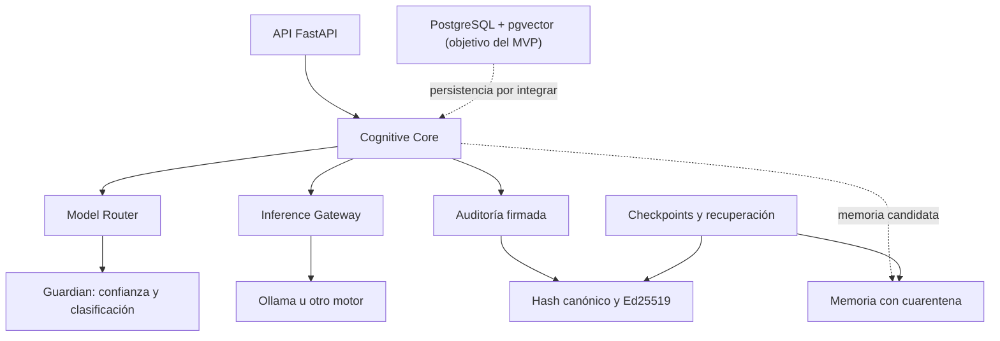

# ATLAS Genesis

ATLAS Genesis es un proyecto para construir una IA cuya identidad operativa, memoria aceptada y
reglas de continuidad no dependan de un único modelo, proveedor o nodo. El proyecto busca una
continuidad técnica verificable y una arquitectura que permita sustituir modelos; no pretende
demostrar conciencia ni que coordinar varios LLM produzca automáticamente mejores resultados.

**Estado:** prototipo temprano: núcleo determinista y rebanada vertical en memoria. No es todavía un
sistema completo, persistente ni distribuido. La licencia está por decidir.

## Qué es ATLAS

La continuidad se define mediante tres elementos: una identidad criptográfica, una constitución
versionada que fija las reglas nucleares y la memoria aceptada con procedencia. Un cambio de modelo
no debe cambiar la identidad; su impacto en el comportamiento debe medirse con pruebas de
continuidad.

Objetivos de diseño:

- Mantener identidad, memoria e historial independientes del modelo de inferencia.
- Admitir modelos y hardware heterogéneos mediante contratos y adaptadores.
- Proteger las tareas antes de ejecutarlas y registrar decisiones críticas de forma verificable.
- Incorporar conocimiento con evaluación, procedencia, cuarentena y posibilidad de revocación.
- Recuperar el estado desde checkpoints verificables y probar esa recuperación.
- Evolucionar con cambios versionados, evaluables y reversibles.

## Arquitectura y principios

El MVP es un **monolito modular** en Python. Los límites entre módulos se comprueban con
`import-linter`; los motores se conectan mediante contratos estables para que extraer servicios
solo tenga sentido cuando exista una necesidad medible.



Principios adoptados en los [ADR](docs/adr/):

1. **El LLM propone; el código determinista valida y decide.** Las decisiones usan JSON estricto;
   las salidas inválidas se rechazan (fail-closed).
2. **La memoria no se acepta directamente desde un LLM o nodo externo.** Pasa por estados de
   cuarentena y validación; fuentes de baja confianza requieren una persona o evidencia de un
   validador determinista.
3. **La confianza y la clasificación de datos se comprueban antes del envío.** Las etiquetas T0-T3
   y D0-D3 son controles de acceso, no garantías de confidencialidad. Un nodo que ejecuta inferencia
   ve el prompt en claro; D2 y D3 deben permanecer en infraestructura controlada (T3) hasta contar
   con inferencia confidencial real.
4. **Auditoría firmada antes que blockchain.** Las firmas prueban integridad y procedencia, no la
   verdad semántica. Una cadena local tampoco detecta por sí sola el truncado de su cola: se prevé
   anclar periódicamente su cabeza en un medio externo.
5. **SINGLE primero.** El MVP enruta una tarea a un modelo. DISTRIBUTED, COLLABORATIVE y HYBRID se
   habilitarán más adelante y solo con pruebas que justifiquen su coste y complejidad.

## Model Mesh

El Model Mesh abstrae el catálogo de modelos, sus capacidades y recursos, la selección de nodos, la
ejecución mediante un gateway y la validación del resultado. `InferenceProvider` (también disponible
con el nombre previo `InferencePort`) define el contrato independiente del motor; `OllamaAdapter`
lo implementa usando la API local de chat de Ollama, sin SDK propietario. El gateway respeta el
timeout solicitado, admite salida JSON Schema y comunica timeouts, fallos de transporte, errores HTTP
y respuestas inválidas como errores explícitos. El núcleo registra `inference.failed` con el tipo
de error y la asignación fallida, sin incluir el prompt ni la respuesta, y vuelve a propagar el error.

El router del MVP filtra por salud del nodo, confianza, clase de datos, aprobación del modelo,
capacidades, contexto y VRAM estimada. Puede limitar la latencia usando `TaskRequest.max_latency_ms`;
solo la métrica medida `ModelSpec.eval_latency_ms` satisface ese límite. Después ordena por calidad
medida, latencia medida disponible y consumo estimado. Sin un límite de latencia, no tener esa
métrica no excluye al modelo. El adaptador debe configurarse con el endpoint de un motor local
confiable; no envía prompts a un servicio comercial.

| Estrategia | Alcance |
|---|---|
| `SINGLE` | MVP: una tarea en un modelo y nodo elegibles. |
| `DISTRIBUTED` | Fase posterior: dividir tareas en subtareas coordinadas entre nodos. |
| `COLLABORATIVE` | Fase posterior y condicionada a evidencia: comparar resultados independientes. |
| `HYBRID` | Fase posterior y condicionada a evidencia: combinar distribución y colaboración. |

Distribuir tareas entre nodos es distinto de repartir los pesos de un único modelo entre varias
GPU. Esta última capacidad queda fuera del alcance inicial.

### Confianza y datos

| Nivel de nodo | Significado | Clasificación de datos permitida por política |
|---|---|---|
| T0 | No validado | D0 |
| T1 | Comunitario | D0-D1 |
| T2 | Verificado | D0-D2 |
| T3 | Infraestructura propia o controlada | D0-D3 |

| Clase | Uso previsto |
|---|---|
| D0 | Público |
| D1 | Comunitario o anonimizado |
| D2 | Interno |
| D3 | Confidencial o crítico |

La política del código es la autoridad para el envío; la tabla resume la regla adoptada, no una
certificación de seguridad. No se deben enviar claves privadas, credenciales ni secretos a los LLM.

## Estado real de la implementación

**Implementado como componentes/prototipo:**

- Hash canónico y firmas Ed25519.
- Log de auditoría encadenado y firmado, con verificación de cadena.
- Contrato estricto de decisión JSON y rechazo de salidas inválidas.
- Política básica de clasificación y confianza.
- Ciclo de vida de memoria candidata con cuarentena y transiciones controladas.
- Router `AUTO`/`SINGLE` con filtros de política y estimación de VRAM.
- Puertos de inferencia, gateway falso para pruebas y adaptador HTTP para Ollama.
- Manifiestos de checkpoint firmados y raíz de Merkle.
- Esquema inicial PostgreSQL/pgvector y pruebas unitarias/de integración del núcleo en memoria.

**Pendiente para un MVP funcional:**

- El endpoint `POST /api/v1/chat` todavía devuelve HTTP 501; la API solo tiene health check operativo.
- Conectar la API al Cognitive Core, definir autenticación y aplicar la clasificación en el borde.
- Probar Ollama contra un servidor real y configurar el flujo de inferencia de extremo a extremo.
- Persistir identidad, auditoría, memoria, tareas y checkpoints en PostgreSQL.
- Implementar y probar recuperación desde un entorno limpio; el manifiesto por sí solo no restaura
  servicios ni datos.
- El agente de nodo actual es una sonda; todavía no hay un mesh operativo ni coordinación multi-nodo.
- Los módulos de learning y evolution aún no implementan aprendizaje o evolución de producción.

Estas distinciones evitan presentar los objetivos del diseño como capacidades ya disponibles.
Consulta el [roadmap vigente](docs/roadmap.md) y el [plan de implementación paso a paso](docs/implementation-plan.md).

## Tecnologías

- **Base:** Python 3.12+, FastAPI, contratos propios y Ed25519 (`cryptography`).
- **Inferencia:** puerto desacoplado, gateway falso para pruebas y adaptador Ollama inicial.
  llama.cpp y vLLM son candidatos futuros, no integraciones actuales.
- **Persistencia objetivo del MVP:** PostgreSQL con pgvector como fuente de verdad; los embeddings
  serán derivados y reconstruibles. Qdrant, colas, workflows durables e IPFS quedan pospuestos hasta
  que una necesidad y medición los justifiquen.
- **Infraestructura:** Docker Compose está preparado para PostgreSQL y un perfil opcional de Ollama.
- **Calidad:** pytest, Ruff, mypy e import-linter.
- **Futuro condicionado:** anclaje externo, blockchain y gobernanza multiparte; no son requisitos
  del MVP ni sustituyen respaldos y recuperación.

## Interfaces previstas y objetivos operativos

La API actual solo expone `GET /api/v1/health` y el endpoint de chat aún no está implementado. Como
contratos futuros se contemplan identidad, chat, memoria, aprendizaje/evolución, checkpoints,
recuperación y operaciones del Mesh (nodos, modelos, tareas, resultados y evaluaciones). Las rutas
finales deben publicarse en OpenAPI y probarse como contratos antes de considerarlas estables; los
contratos previstos no equivalen a una API disponible.

Los siguientes valores proceden de la especificación inicial: son **objetivos provisionales**, no
garantías ni resultados medidos.

| Indicador | Objetivo inicial |
|---|---|
| Disponibilidad operativa | 99,5 % |
| RTO (tiempo objetivo de recuperación) | ≤ 24 horas |
| RPO (pérdida de datos objetivo) | ≤ 1 hora |
| Redundancia | Al menos 3 dominios o proveedores independientes |
| Integridad de artefactos aprobados | Verificación del 100 % |
| Portabilidad | Restauración probada en infraestructura alternativa |

Estos objetivos solo se adoptarán como compromisos cuando se midan en ejercicios operativos y se
documenten sus límites y costes.

## Empezar

Requiere Python 3.12 o posterior. En Windows PowerShell:

```powershell
py -3.12 -m venv .venv
.\.venv\Scripts\Activate.ps1
python -m pip install -e ".[dev,db]"
python -m pytest -q
```

En Linux o macOS:

```bash
python3.12 -m venv .venv
. .venv/bin/activate
python -m pip install -e ".[dev,db]"
python -m pytest -q
```

Con `make` disponible, `make check` ejecuta lint, fronteras de arquitectura, typecheck y pruebas.
PostgreSQL es opcional para las pruebas actuales; para levantarlo con Compose, define
`POSTGRES_PASSWORD` localmente antes de ejecutar `docker compose up -d postgres`. No guardes ese
secreto en el repositorio. La migración se monta como inicialización de una base de datos nueva.

## Mapa del repositorio

| Ruta | Responsabilidad |
|---|---|
| `src/atlas/cognitive` | Contrato de decisión y Cognitive Core. |
| `src/atlas/guardian` | Política de niveles de confianza y clasificación de datos. |
| `src/atlas/memory` | Ciclo de vida de memoria candidata. |
| `src/atlas/identity` | Modelo inicial de identidad versionada. |
| `src/atlas/audit` | Log encadenado y firmado. |
| `src/atlas/persistence` | Manifiestos, Merkle y verificación de checkpoints. |
| `src/atlas/mesh` | Modelos, estimación de recursos, router, validador y gateways. |
| `src/atlas/api` | Aplicación FastAPI; chat aún no implementado. |
| `src/atlas_node` | Sonda inicial para un nodo. |
| `database/migrations` | Esquema PostgreSQL/pgvector inicial. |
| `contracts` | Contratos OpenAPI y esquemas JSON. |
| `benchmarks/continuity` | Casos golden para medir continuidad entre modelos. |
| `docs/adr` | Decisiones de arquitectura. |
| `docs/roadmap.md` | Fases vigentes del proyecto. |
| `tests` | Pruebas unitarias, integración, seguridad y recuperación. |

## Documentación y contribución

- [Roadmap](docs/roadmap.md): objetivos y dependencias de alto nivel.
- [Plan de implementación](docs/implementation-plan.md): pasos cortos con criterios verificables
  para cerrar cada fase.
- [Arquitectura](docs/architecture/overview.md) y [modelo de amenazas](docs/architecture/threat-model.md).
- [Seguridad](SECURITY.md) y [guía de contribución](CONTRIBUTING.md).
- [Flujo de Issues y delegación a Copilot](docs/ISSUE_WORKFLOW.md).
- Las instrucciones generales de Copilot están en `.github/copilot-instructions.md`, las
  instrucciones por tipo de archivo en `.github/instructions/` y los prompts reutilizables en
  `.github/prompts/`. Los workflows de GitHub Actions están en `.github/workflows/`; son
  automatizaciones de CI, independientes de las instrucciones de Copilot.
- Cuando una descripción de objetivos difiera del código, los ADR o el roadmap revisado, prevalecen
  las decisiones y el alcance más recientes.

Contribuye con cambios pequeños, pruebas y documentación. Antes de proponer un cambio arquitectónico,
revisa los ADR y añade uno si cambia una decisión vigente. No incluyas secretos, datos personales ni
artefactos de modelos cuya procedencia y licencia no se hayan verificado.
