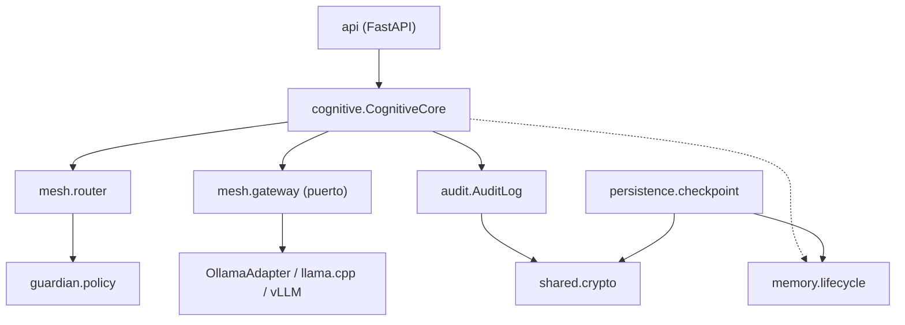

# Arquitectura (MVP)

Las capas solo se importan hacia abajo (contrato `.importlinter`). El Cognitive Core no puede
importar `shared.crypto`: el código que procesa texto probabilístico nunca toca claves.

## README original → MVP

| Componente | MVP | Dónde / cuándo |
|---|---|---|
| Cognitive Core, Guardian, Identity, Memory, Persistence | Sí (núcleo) | `src/atlas/*` |
| Model Mesh: registry, node manager, router SINGLE, gateway Ollama | Sí | `mesh/` |
| Router DISTRIBUTED | Fase 3 | tras multi-nodo propio (T3) |
| COLLABORATIVE / HYBRID | Fase 6, condicionado a evidencia | ADR-0005 |
| Trust tiers para nodos externos | Fase 5 (antes de abrir la red) | `guardian/` |
| Learning / Evolution | Fase 7, solo proponen | stubs |
| Blockchain / Economy | Fase 8+ | `contracts/smart-contracts/` |
| Distribución de pesos entre GPU | Fuera de alcance | — |
